# Student Grade Management System

An enterprise-grade Java 25 console application for managing students, grades,
GPA calculations, statistics, file-based reporting, and concurrent background
processing.

---

## Class Diagram

The diagram covers every package. Inheritance uses solid arrows; implementation
of an interface uses dashed arrows; composition/association uses plain lines
with multiplicity labels.

```mermaid
classDiagram
    direction TB

    %% ── Model ──────────────────────────────────────────────────────────────
    class Student {
        <<abstract>>
        -String studentId
        -String name
        -int age
        -String email
        -String phone
        -Status status
        -Grade[] grades
        +getStudentId() String
        +getName() String
        +getAge() int
        +getEmail() String
        +getPhone() String
        +getStatus() Status
        +addGrade(Grade) void
        +getGrades() Grade[]
        +calculateAverageGrade() double
        +isPassing() boolean
        +getStudentType() String*
        +getPassingGrade() double*
    }
    class RegularStudent {
        +getStudentType() String
        +getPassingGrade() double
    }
    class HonorsStudent {
        -double honorsThreshold
        +getStudentType() String
        +getPassingGrade() double
        +checkHonorsEligibility() boolean
    }

    class Subject {
        <<abstract>>
        -String subjectName
        -String subjectCode
        +getSubjectName() String
        +getSubjectCode() String
        +getSubjectType() String*
    }
    class CoreSubject {
        +getSubjectType() String
    }
    class ElectiveSubject {
        +getSubjectType() String
    }

    class Grade {
        <<record>>
        +String gradeId
        +String studentId
        +Subject subject
        +double value
        +LocalDate recordedAt
        +formattedDate() String
        +displayGradeDetails() void
    }

    Student <|-- RegularStudent
    Student <|-- HonorsStudent
    Subject <|-- CoreSubject
    Subject <|-- ElectiveSubject
    Student "1" *-- "0..*" Grade : contains
    Grade --> Subject : for

    %% ── Manager ─────────────────────────────────────────────────────────────
    class Searchable {
        <<interface>>
        +findStudentById(String) Student
        +findStudentsByName(String) Student[]
        +findStudentsByAverage(double, double) Student[]
        +findStudentsByType(String) Student[]
        +findStudentsByPattern(String) Student[]
    }
    class StudentManager {
        -LinkedHashMap students
        +addStudent(Student) void
        +getStudents() Student[]
        +getStudentCount() int
        +editStudent(String, String, int, String, String) void
    }
    class GradeManager {
        -Grade[] grades
        +addGrade(Grade) void
        +recordGrade(Student, Subject, double) void
        +getGradesByStudent(String) Grade[]
        +getGrades() Grade[]
        +getGradeCount() int
    }
    class StatisticsCalculator {
        +calculate(Grade[]) StatisticsResult
    }
    class StatisticsResult {
        +double mean
        +double median
        +double highest
        +double lowest
        +double standardDeviation
        +int gradeCount
    }

    Searchable <|.. StudentManager
    StudentManager --> Student : stores
    GradeManager --> Grade : stores
    StatisticsCalculator --> StatisticsResult : produces

    %% ── Grading ─────────────────────────────────────────────────────────────
    class GradeScale {
        <<interface>>
        +toGpaPoints(double) double
        +toLetterGrade(double) String
    }
    class FourPointGradeScale {
        +toGpaPoints(double) double
        +toLetterGrade(double) String
    }
    class GPACalculator {
        +calculateGPA(Student) StudentGPAResult
    }
    class StudentGPAResult {
        +String studentId
        +double gpa
        +String letterGrade
        +double average
    }

    GradeScale <|.. FourPointGradeScale
    GPACalculator --> GradeScale : uses
    GPACalculator --> StudentGPAResult : produces

    %% ── Report ──────────────────────────────────────────────────────────────
    class GradeReport {
        <<record>>
        +Student student
        +Grade[] grades
        +double overallAverage
        +double coreAverage
        +double electiveAverage
        +boolean passing
        +generateTextReport() String
        +generateJsonReport() String
        +generateCsvReport() String
    }
    class GradeReportService {
        +createReport(String) GradeReport
    }
    class GradeReportExporter {
        <<interface>>
        +export(GradeReport, Path) void
    }
    class GradeReportImporter {
        <<interface>>
        +importReport(Path) ImportedGradeReport
    }
    class GradeReportFileService {
        +export(GradeReport, Path, String) void
        +importReport(Path) ImportedGradeReport
    }
    class CsvGradeReportExporter { +export(GradeReport, Path) void }
    class JsonGradeReportExporter { +export(GradeReport, Path) void }
    class BinaryGradeReportExporter { +export(GradeReport, Path) void }
    class TextGradeReportExporter { +export(GradeReport, Path) void }
    class CsvGradeReportImporter { +importReport(Path) ImportedGradeReport }
    class JsonGradeReportImporter { +importReport(Path) ImportedGradeReport }
    class BinaryGradeReportImporter { +importReport(Path) ImportedGradeReport }

    class StudentImporter {
        <<interface>>
        +importStudents(Path) List~StudentRecord~
    }
    class CsvStudentImporter { +importStudents(Path) List~StudentRecord~ }
    class JsonStudentImporter { +importStudents(Path) List~StudentRecord~ }
    class BinaryStudentImporter { +importStudents(Path) List~StudentRecord~ }
    class StudentImportService {
        +importStudents(Path) int
    }

    GradeReportService --> StudentManager : queries
    GradeReportService --> GradeManager : queries
    GradeReportService --> GradeReport : produces
    GradeReportExporter <|.. CsvGradeReportExporter
    GradeReportExporter <|.. JsonGradeReportExporter
    GradeReportExporter <|.. BinaryGradeReportExporter
    GradeReportExporter <|.. TextGradeReportExporter
    GradeReportImporter <|.. CsvGradeReportImporter
    GradeReportImporter <|.. JsonGradeReportImporter
    GradeReportImporter <|.. BinaryGradeReportImporter
    GradeReportFileService --> GradeReportExporter : delegates
    GradeReportFileService --> GradeReportImporter : delegates
    StudentImporter <|.. CsvStudentImporter
    StudentImporter <|.. JsonStudentImporter
    StudentImporter <|.. BinaryStudentImporter
    StudentImportService --> StudentImporter : uses
    StudentImportService --> StudentManager : registers into

    %% ── Services ────────────────────────────────────────────────────────────
    class StudentApplicationService {
        +addStudent() void
        +viewStudents() void
        +editStudent() void
        +deactivateStudent() void
        +activateStudent() void
    }
    class GradeService {
        +recordGrade() void
    }
    class BulkImportService {
        +importCSV(String) ImportSummary
        +importCSVParallel(String, int, AuditTrail) ImportSummary
    }
    class RankingService {
        +rankByGpa(Student[]) List~StudentRanking~
        +rankByAverage(Student[]) List~StudentRanking~
    }
    class StudentSearchService {
        +search() void
    }
    class ConcurrentReportService {
        +generate(Student[]) List~GradeReport~
        +close() void
    }
    class StatisticsDashboard {
        +start(long, TimeUnit, Consumer) void
        +stop() void
    }
    class ScheduledGpaProcessor {
        +start() void
        +close() void
    }

    StudentApplicationService --> StudentManager : uses
    StudentApplicationService --> GradeManager : uses
    GradeService --> StudentManager : uses
    GradeService --> GradeManager : uses
    BulkImportService --> StudentManager : queries
    BulkImportService --> GradeManager : writes
    BulkImportService --> ParallelBatchProcessor : uses
    BulkImportService --> AuditTrail : logs to
    RankingService --> GPACalculator : uses
    StudentSearchService --> StudentManager : uses
    StudentSearchService --> ThreadSafeLruCache : caches in
    ConcurrentReportService --> GradeReportService : uses
    StatisticsDashboard --> StatisticsCalculator : uses
    ScheduledGpaProcessor --> GPACalculator : uses
    ScheduledGpaProcessor --> StudentManager : reads

    %% ── Infrastructure ──────────────────────────────────────────────────────
    class ThreadSafeLruCache {
        -int capacity
        -long ttlMillis
        +get(K) Optional~V~
        +put(K, V) void
        +invalidate(K) void
        +clear() void
    }
    class ParallelBatchProcessor {
        -int workerCount
        +process(List~I~) List~O~
        +close() void
    }
    class AuditTrail {
        +record(String, String) void
        +close() void
    }
    class ValidationPatterns {
        +requireStudentId(String) String
        +requireEmail(String) String
        +requirePhone(String) String
        +requireCourseCode(String) String
    }
    class ApplicationLogger {
        +info(String) void
        +warning(String) void
        +error(String, Throwable) void
    }

    %% ── Input ───────────────────────────────────────────────────────────────
    class InputReader {
        <<interface>>
        +readInt(String, int, int) int
        +readDouble(String, double, double) double
        +readRequired(String) String
        +readEmail(String) String
        +readName(String) String
        +readOptional(String) String
        +pause() void
    }
    class ConsoleInputReader {
        #readLine(String) String
    }
    InputReader <|.. ConsoleInputReader

    %% ── View ────────────────────────────────────────────────────────────────
    class Menu {
        +start() void
        +handleOptions(int) boolean
    }
    class StudentView {
        +display(Student) void
    }
    class GradeReportView {
        +display() void
    }
    class StatisticsView {
        +displayStatistics() void
    }
    class GPAView {
        +displayStudentGPA() void
    }
    class ExportReportView {
        +export() void
    }

    Menu --> InputReader : reads via
    Menu --> StudentApplicationService : uses
    Menu --> GradeService : uses
    Menu --> BulkImportService : uses
    Menu --> StudentSearchService : uses
    Menu --> GradeReportView : delegates to
    Menu --> StatisticsView : delegates to
    Menu --> ExportReportView : delegates to
    Menu --> GPAView : delegates to
    Menu --> StudentImportService : uses
    Menu --> ConcurrentReportService : uses
    Menu --> GradeReportFileService : uses
    GradeReportView --> GradeReportService : uses
    ExportReportView --> GradeReportFileService : uses
    GPAView --> GPACalculator : uses
    StatisticsView --> StatisticsCalculator : uses
    StudentApplicationService --> StudentView : renders via

    %% ── Exceptions ──────────────────────────────────────────────────────────
    class InvalidInputException { +String message }
    class StudentNotFoundException
    class ImportFormatException
    class InvalidGradeException { +double value }
    class CapacityExceededException
    class FileExportException

    InvalidInputException <|-- StudentNotFoundException
    InvalidInputException <|-- ImportFormatException
```



---

## Use Case Diagram

The Teacher is the sole external actor. System behaviour is grouped into five

```mermaid
flowchart TD
    T(["👤 Teacher /\nAcademic Administrator"])

    subgraph SM["Student Management"]
        UC1["Add Student\n(Regular or Honors)"]
        UC2["View All Students"]
        UC14["Edit Student"]
        UC15["Deactivate Student"]
        UC16["Activate Student"]
        UC11["Import Students\n(CSV / JSON / Binary)"]
    end

    subgraph GM["Grade Management"]
        UC3["Record Grade\n(Core or Elective)"]
        UC7["Bulk Import Grades\n(CSV)"]
        UC17["Full Import Pipeline\n(students + grades)"]
    end

    subgraph RP["Reporting"]
        UC4["View Grade Report"]
        UC5["Export Grade Report\n(CSV / JSON / Binary / Text)"]
        UC12["Generate Batch Reports\n(concurrent)"]
        UC13["Import Grade Report"]
    end

    subgraph AN["Analytics"]
        UC6["Calculate Student GPA"]
        UC8["View Class Statistics"]
        UC10["View Student Rankings"]
    end

    subgraph SR["Search"]
        UC9a["Search by Name\n(partial match)"]
        UC9b["Search by ID"]
        UC9c["Search by Average Range"]
        UC9d["Search by Student Type"]
        UC9e["Search by Regex Pattern"]
    end

    subgraph SYS["System"]
        VAL["Validate Input"]
        GENID["Generate Student / Grade IDs"]
        AUDIT["Record Audit Trail"]
        CACHE["Cache Search Results"]
        LOG["Log Application Events"]
    end

    T --> UC1
    T --> UC2
    T --> UC14
    T --> UC15
    T --> UC16
    T --> UC11
    T --> UC3
    T --> UC7
    T --> UC17
    T --> UC4
    T --> UC5
    T --> UC12
    T --> UC13
    T --> UC6
    T --> UC8
    T --> UC10
    T --> UC9a
    T --> UC9b
    T --> UC9c
    T --> UC9d
    T --> UC9e

    UC1 -. "<<include>>" .-> VAL
    UC1 -. "<<include>>" .-> GENID
    UC3 -. "<<include>>" .-> VAL
    UC3 -. "<<include>>" .-> GENID
    UC14 -. "<<include>>" .-> VAL
    UC7 -. "<<include>>" .-> AUDIT
    UC17 -. "<<extend>>" .-> UC7
    UC17 -. "<<extend>>" .-> UC11
    UC5 -. "<<include>>" .-> UC4
    UC12 -. "<<include>>" .-> UC4
    UC9e -. "<<extend>>" .-> UC9a
    UC9e -. "<<include>>" .-> CACHE
    UC1 -. "<<include>>" .-> LOG
    UC3 -. "<<include>>" .-> LOG
    UC7 -. "<<include>>" .-> LOG
```

functional areas. Dashed arrows show `<<include>>` (mandatory sub-behaviour)
and `<<extend>>` (optional enhancement).



---

## Requirements

- Java 25 or newer (uses `IO.readln`, `IO.println`, records, switch expressions)
- Maven 3.9 or newer
- IntelliJ IDEA (recommended) or any Java 25-compatible IDE

## Project structure

```text
SGMS/
├── src/
│   ├── app/           Main.java — bootstrap and dependency wiring
│   ├── model/         Student, RegularStudent, HonorsStudent,
│   │                  Grade (record), Subject, CoreSubject, ElectiveSubject
│   ├── manager/       StudentManager, GradeManager,
│   │                  StatisticsCalculator, StatisticsResult, Searchable
│   ├── grading/       GPACalculator, GradeScale, FourPointGradeScale
│   ├── report/        GradeReportService, GradeReport, GradeReportFileService,
│   │                  exporters (CSV/JSON/Binary/Text),
│   │                  importers (CSV/JSON/Binary),
│   │                  StudentImporter, StudentImportService
│   ├── services/      StudentApplicationService, GradeService,
│   │                  BulkImportService, RankingService,
│   │                  StudentSearchService, ConcurrentReportService,
│   │                  StatisticsDashboard, ScheduledGpaProcessor
│   ├── view/          Menu, StudentView, GradeReportView,
│   │                  StatisticsView, GPAView, ExportReportView
│   ├── input/         InputReader (interface), ConsoleInputReader
│   ├── cache/         ThreadSafeLruCache
│   ├── batch/         ParallelBatchProcessor
│   ├── audit/         AuditTrail
│   ├── validation/    ValidationPatterns
│   ├── logging/       ApplicationLogger
│   └── exceptions/    InvalidInputException, StudentNotFoundException,
│                      ImportFormatException, InvalidGradeException,
│                      CapacityExceededException, FileExportException
├── test/              JUnit 5 + Mockito test suites (mirrors src/)
├── data/
│   ├── students/      students.csv, students.json
│   └── grades/        grades_sample.csv, grades_bad_rows.csv
└── imports/           Drop CSV files here for bulk grade import
```

## Running the application

### IntelliJ IDEA

1. Open the project and set the project SDK to Java 25 or newer.
2. Run `src/app/Main.java`.

### Maven

```bash
mvn compile exec:java -Dexec.mainClass="app.Main"
```

### Command line (Windows)

```powershell
New-Item -ItemType Directory -Force out | Out-Null
javac --release 25 -d out $(Get-ChildItem -Path src -Recurse -Filter *.java |
    Select-Object -ExpandProperty FullName)
java -cp out app.Main
```

## Menu options

| # | Option | Description |
|---|--------|-------------|
| 1 | Add Student | Register a new Regular or Honors student |
| 2 | View Students | List all students with averages and status |
| 3 | Record Grade | Enter a Core or Elective grade (0–100) |
| 4 | View Grade Report | Display a student's full grade history |
| 5 | Export Grade Report | Save a report as CSV, JSON, Binary, or Text |
| 6 | Calculate Student GPA | Convert averages to a 4.0 GPA scale |
| 7 | Bulk Import Grades | Load grades from a CSV file |
| 8 | View Class Statistics | Mean, median, std dev, distribution |
| 9 | Search Students | By name, ID, average range, type, or regex |
| 10 | Exit | Close the application |
| 11 | Import Students | Load students from CSV, JSON, or Binary |
| 12 | Generate Batch Reports | Concurrent report generation for all students |
| 13 | Import Grade Report | Load a previously exported grade report |
| 14 | Edit Student | Update name, age, email, or phone |
| 15 | Deactivate Student | Set status to INACTIVE |
| 16 | Activate Student | Set status back to ACTIVE |
| 17 | Full Import Pipeline | Import students and grades in one step |

## Grading rules

| Student type | Passing grade |
|---|---:|
| Regular | 50% |
| Honors | 60% |

| Percentage | GPA | Letter |
|---|---|---|
| 93–100% | 4.0 | A |
| 90–92% | 3.7 | A− |
| 87–89% | 3.3 | B+ |
| 83–86% | 3.0 | B |
| 80–82% | 2.7 | B− |
| 77–79% | 2.3 | C+ |
| 73–76% | 2.0 | C |
| 70–72% | 1.7 | C− |
| 67–69% | 1.3 | D+ |
| 60–66% | 1.0 | D |
| Below 60% | 0.0 | F |

## Object-oriented design highlights

- `Student` is abstract; `RegularStudent` and `HonorsStudent` override the
  student type label and passing threshold (polymorphism).
- `Grade` is a record — immutable, auto-generates an ID, and validates the
  student ID and grade range before claiming the ID counter.
- `Subject` is abstract; `CoreSubject` and `ElectiveSubject` provide the
  subject type string (open/closed principle).
- `GradeReportExporter` and `GradeReportImporter` are interfaces with four and
  three implementations respectively — new formats require no changes to
  existing code (open/closed principle).
- `StudentManager` implements `Searchable`, keeping search contracts separate
  from storage concerns (interface segregation principle).
- `BulkImportService` accepts a `ParallelBatchProcessor` and `AuditTrail` via
  its constructor (dependency inversion principle).
- `ThreadSafeLruCache` backs regex search results with TTL eviction and
  bounded capacity for safe concurrent access.

## Testing and coverage

```bash
# Run all tests
mvn test

# Run a single test class
mvn test -Dtest=GPACalculatorTest

# Generate Surefire HTML report
mvn surefire-report:report
```

Reports are written to `target/surefire-reports/`. For JaCoCo coverage:

```bash
mvn verify
```

Then open `target/site/jacoco/index.html`.

| Metric | Target |
|---|---:|
| Instructions | 80%+ |
| Lines | 80%+ |
| Methods | 83%+ |
| Classes | 90%+ |
| Branches | 70%+ |

## Git workflow

```
main          ← production; merged from dev after all tests pass
  └── dev     ← integration branch
        ├── feature/<name>
        ├── bugfix/<name>
        └── hotfix/<name>
```

```bash
git checkout dev && git pull origin dev
git checkout -b feature/my-feature
# … commits …
git push -u origin feature/my-feature
# open PR → dev; CI runs mvn test
# after approval: merge to dev, then dev → main
```

Commit format: `<type>: <summary>` where type is one of
`feat`, `fix`, `test`, `refactor`, `docs`, `chore`.

## Project documentation

- [Student Grade Management II requirements](Student-Grade-Mgt-II.md)
- [Student Grade Management III requirements](Student-Grade-Mgt-III.md)
